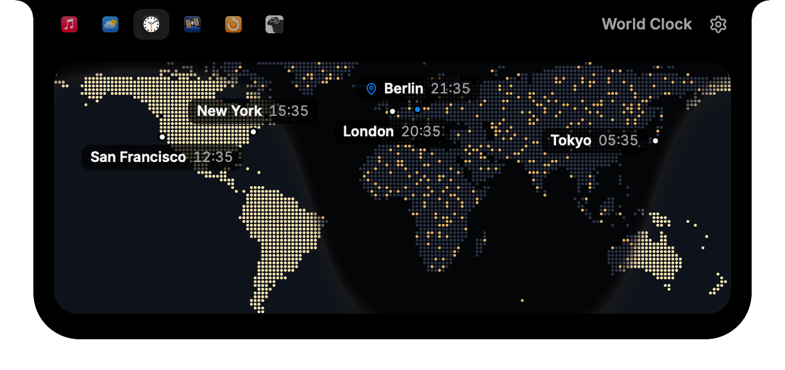
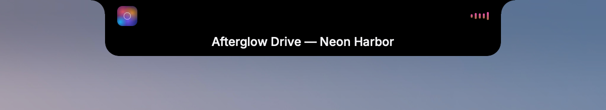
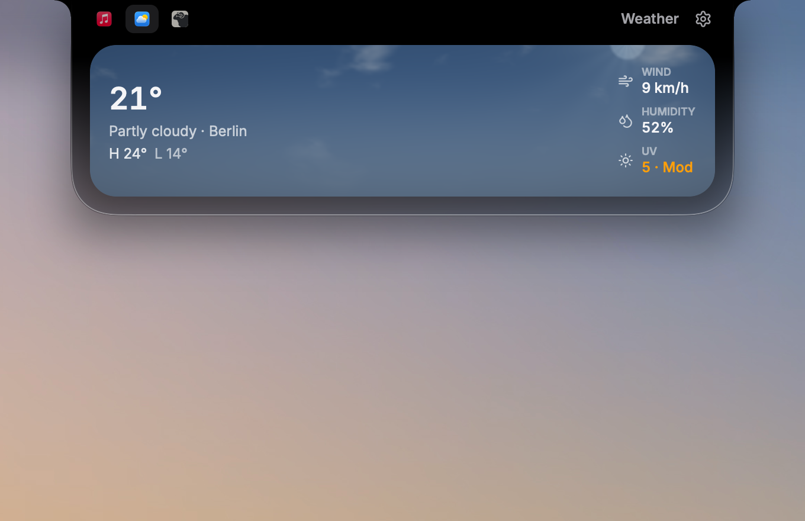
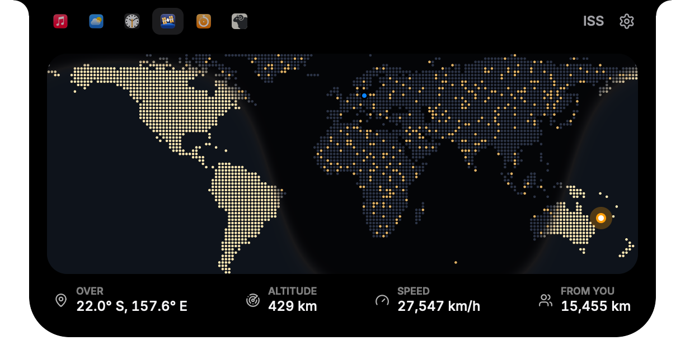
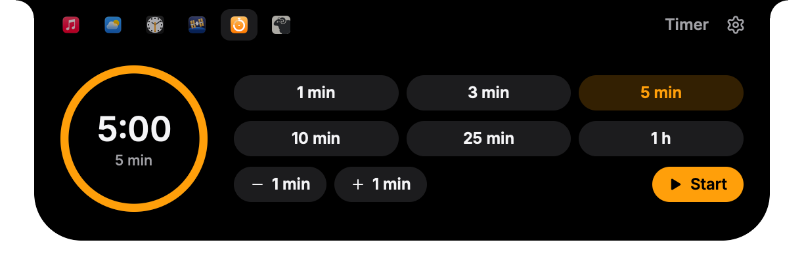
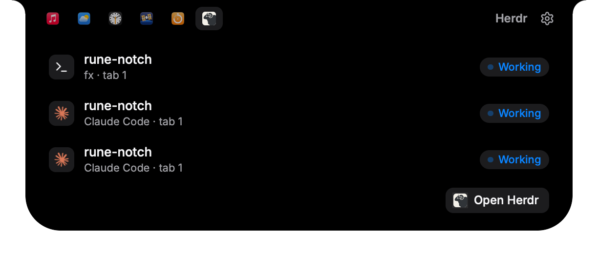

# openNook

openNook is a Dynamic Island for the MacBook notch where **everything the island shows is a
mod**: a small folder of JavaScript that you, or your coding agent, write and edit while it
runs. It's native and GPU-rendered with [Rune](https://github.com/anomalyco/rune); mods run on
QuickJS off the UI thread, so a broken one can't stall the notch.

> 2.0 is a rewrite on Rune (the 1.x GPUI app lives in git history). It's alpha: macOS first.

<p align="center"></p>

<p align="center">
  
  
</p>

<table>
  <tr>
    <td></td>
    <td></td>
  </tr>
  <tr>
    <td></td>
    <td></td>
  </tr>
</table>

## Install

Download `openNook-<version>.dmg` from [Releases](https://github.com/prodBirdy/openNook/releases),
drag openNook to Applications and open it. It lives in the notch only; there's no Dock icon or
menu-bar item. Settings › Permissions asks for what the shipped mods use: System Audio
Recording (the music meter reads loudness only), Location (or set a place in General) and
Automation (Music and Spotify).

The app is also the CLI:

```bash
ln -s /Applications/openNook.app/Contents/MacOS/openNook ~/.local/bin/opennook
opennook paths
```

## How it works

Closed, the island sits around the camera and shows one thing beside it: the track playing,
an agent at work, a dictation in progress. Open (hover or click), it shows each mod's page.

```
~/.config/opennook/
  AGENTS.md         the guide an agent reads before changing anything
  nook.d.ts, ui.d.ts  the mod API, exactly
  layout.json       who wins the closed island, page order, theme, size
  mods/<name>/      main.js + mod.json: one mod each
```

Ask your agent for what you want ("show my open PRs", "a pomodoro beside the camera", "show
when my Docker build fails") and point it at `~/.config/opennook/AGENTS.md`. Saved changes
apply within a second; a broken edit keeps the last good version and writes why to
`mods/<name>.error`.

```js
import { View, row, text, icon } from "nook/ui";
import { media, run } from "nook";

export default class Player extends View {
  activity() {
    const m = media();
    return m?.playing ? { leading: icon("music").color("green"), trailing: text(m.artist ?? "") } : null;
  }
  expanded() {
    const m = media();
    return row().gap(12).child(text(m?.title ?? "Nothing playing").font_semibold())
      .child(icon("media-skip-forward").on_click(() => run("media.next")));
  }
}
```

Mods read live data (Now Playing, coding agents, running apps), run programs, fetch URLs,
follow log files and watch state files, so integrating another app is usually a few lines.
The shipped `herdr` mod reads [Herdr](https://github.com/herdrdev/herdr)'s `hc ls --json` and
jumps to an agent with `herdr-app do agent.focus`.

Shipped mods: **now-playing** (with a music meter that follows the sound), **weather** (an
animated WGSL sky with the real moon phase), **world-clock** (a dot-matrix world lit where the
sun is up, with your cities), **iss** (where the station is, its next orbit, altitude and
speed), **timer** (presets, a ring, a chime) and **herdr**.

## Build and run

```bash
cargo run -p nook --release              # the island
cargo run -p nook -- check <mod folder>  # load a mod, report its views or its error
cargo run -p nook -- shot island.png     # render the island to a PNG (--open, --mod <name>)
./scripts/bundle.sh                      # target/openNook.app
./scripts/installer.sh                   # target/openNook-<version>.dmg
./scripts/screens.sh                     # re-render docs/screens
```

Now Playing uses [mediaremote-adapter](https://github.com/ungive/mediaremote-adapter) on
macOS 15.4+: `./scripts/build-mediaremote-adapter.sh` builds it into `third_party/`.

Hover the island to peek, click or swipe down with two fingers to open it, swipe sideways
to switch pages. Right-click it for the mods folder, the guide, Settings and Quit.

## Layout

- `crates/nook`: the app. The island (shape, states, motion), mod elements as Rune views, the
  services mods read, the CLI, and the shipped mods (`crates/nook/mods`).
- `crates/nook-mods`: the mod runtime. QuickJS contexts, the `nook` and `nook/ui` modules,
  live reload, error files, `check`.
- `crates/nook-core`: platform services: MediaRemote, coding agents, EventKit, weather and
  more, shared with 1.x.

## License

MIT. See [LICENSE](LICENSE).
